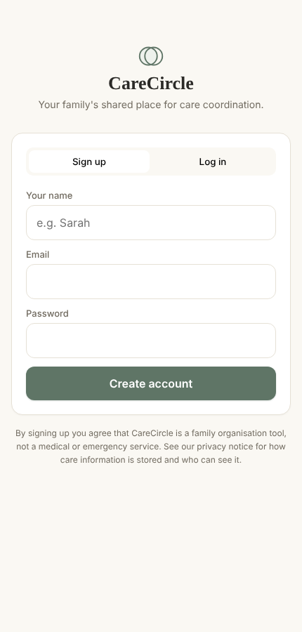
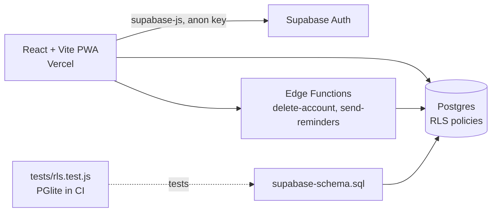

# CareCircle

[](https://github.com/macroer16/carecircle/actions/workflows/ci.yml)

A private shared space for families looking after someone: medications, appointments and notes in one place, so everyone knows what's happening and who's handling it.

**[Open the app](https://carecircle-self.vercel.app)** · Status: **in progress** (working app; some features still need live setup, see below)



## The problem

When a parent or grandparent needs care, the family usually coordinates it through group chats. Medication changes get lost in the scroll, nobody is sure who's taking Mum to Friday's appointment, and there's no single place to check. CareCircle gives each family one private "circle" for that information.

## What it does

- **Care circles:** create a circle and invite family members with a link that expires after 7 days and can be revoked.
- **Medications:** name, dosage, schedule and notes. Removing one is a soft delete, so nothing is lost by accident.
- **Appointments:** date, time, doctor, location and who's taking responsibility.
- **Notes:** a shared log of updates. Only the author can edit or delete their own note.
- **Dashboard:** "since you last checked" changes, upcoming appointments nobody has picked up, and who's handling what.
- **Accounts:** sign up, log in, password reset, and account deletion that won't orphan a circle other people still use.
- **Installable app (PWA)** on phones, with a push-reminder pipeline (needs live setup, see status).

## Security: the part I care about most

This app holds health-related information, so the database itself enforces who can see what, using **PostgreSQL row-level security (RLS)**. Even if someone calls the API directly, the database only returns rows from circles they belong to.

**The RLS rules are tested automatically.** `tests/rls.test.js` runs the real `supabase-schema.sql` in PostgreSQL (via [PGlite](https://pglite.dev), Postgres compiled to WebAssembly) with Supabase-style sign-in, then signs in as four test users (two families, plus an outsider and an anonymous visitor) and checks 24 scenarios:

| Area | What's checked |
|---|---|
| Isolation | A family can't see another family's circle, members, medications, appointments or notes. Outsiders and anonymous visitors see nothing. |
| Spoofing | You can't add data to someone else's circle, write as another user, or create a circle in someone else's name. |
| Escalation | You can't add yourself to a circle directly, promote yourself to owner, or rename a circle you don't own. |
| Data safety | Medications can't be hard-deleted. Records can't be moved into a circle you're not in. Only authors edit their notes. |
| Invitations | Invalid, revoked and expired links are refused. Valid links add a *member*, never an owner. Anonymous visitors can't redeem. |
| Privacy | Push subscriptions are private, even within a family. Profiles are visible only to people in your circles. |

**The tests found a real gap, which is now fixed:** a member could assign an appointment to *any* user, including someone from another family. The insert and update policies now check that the responsible person is in the same circle ([migration](supabase/migrations/2026-10-11-rls-fixes.sql)).

Other hardening: every `SECURITY DEFINER` function sets `search_path = ''` (Supabase advisor rule 0011), joining a circle only happens through a server-side `redeem_invitation()` function, and the "last seen" timestamp is updated through a narrow function rather than an update policy that could let members change their own role.

## How it's built



| Part | Tech |
|---|---|
| Front end | React 18, Vite, installable PWA with a service worker (Workbox) |
| Back end | Supabase: Postgres, Auth, Edge Functions (Deno) |
| Security | Row-level security policies, security-definer functions, soft deletes |
| Tests and CI | Node test runner + PGlite, GitHub Actions running the RLS tests and production build on every push |
| Hosting | Vercel |

## Run it locally

You need Node 20+ and a free [Supabase](https://supabase.com) project.

```bash
git clone https://github.com/macroer16/carecircle.git
cd carecircle
npm install
cp .env.example .env.local   # add your Supabase URL and anon key
npm run dev
```

In your Supabase project, run `supabase-schema.sql` once in the SQL Editor.

## Tests

```bash
npm test
```

No Supabase project is needed for the tests. They run the schema in a local in-memory PostgreSQL.

## Status

| Feature | Status |
|---|---|
| Sign-up, circles, medications, appointments, notes | Working on the live app |
| RLS policies | 24 automated tests passing. Fix written; **run the migration on the live database** |
| Invitations (create, redeem, revoke, expiry) | Logic tested automatically. A full live test with two real accounts is still to do |
| Account deletion | Edge Function written, not yet deployed |
| Push reminders | Pipeline built. Needs VAPID keys, function deployment and scheduling |
| Known issue | Reminder times use UTC, so they'll be an hour out during British Summer Time |

Planning, research and the full build history are in [`docs/`](docs/).

## What I learned

_TODO (Victor writes this)_

## Next steps

- [ ] Run the RLS migration on the live database, then a two-account test on the live app
- [ ] Deploy the delete-account Edge Function
- [ ] Set up push reminders and fix time zones
- [ ] Editing for medications and appointments (currently delete and re-add)

Built by [Victor Benson](https://macroer16.github.io/victor-cloud-portfolio/).
